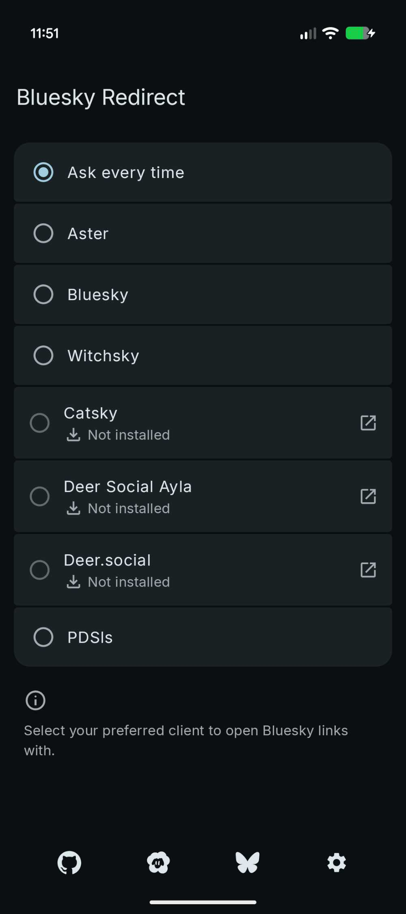
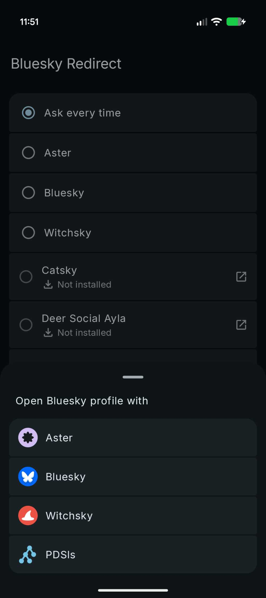

# Bluesky Redirect

Redirect Bluesky links and other client's links in your preferred Bluesky client.

This app is heavily based on the work of [zacharee](https://github.com/zacharee)'s [Mastodon Redirect](https://github.com/zacharee/MastodonRedirect). The original license is included in the repository, and the code has been modified to work with Bluesky links and clients.

## Screenshots

 

## Downloads

### GitHub
[](https://github.com/turtlepaw/BlueskyRedirect/releases)

[](https://apps.obtainium.imranr.dev/redirect?r=obtainium://add/https://github.com/turtlepaw/BlueskyRedirect/releases)

### IzzyOnDroid
<a href="https://apt.izzysoft.de/packages/io.github.turtlepaw.blueskyredirect"></a>

## Supported Domains

- [bsky.app](https://bsky.app)
- [main.bsky.app](https://main.bsky.app)
- [Catsky](https://catsky.social)
- [Deer.social](https://deer.social)
- [Deer Social Ayla](https://deer-social-ayla.pages.dev)
- [Deer Aylac](https://deer.aylac.top)
- [social.daniela.lol](https://social.daniela.lol)
- [Blacksky](https://blacksky.community)
- [Witchsky](https://witchsky.app)
- [impro.social](https://impro.social)
- [Red Dwarf](https://reddwarf.app)
- [bluepy.social](https://bluepy.social)
- [Anisota](https://anisota.net)
- [mu.social](https://mu.social)
- [Northsky](https://northsky.app)
- [aturi.to](https://aturi.to)

## Setup
If any domains aren't enabled for handling, the app will let you know and provide you buttons for enabling them.

Enabling each supported domain one at a time is possible, but tedious. Instead, you can use [Shizuku](https://shizuku.rikka.app) to automatically enable all links at once. The setup for Shizuku is a little complex, but can be done completely on-device on Android 11 and later. It is also only needed once for the initial setup or for enabling domains added in app updates.

Alternatively, you can use [LinkSheet](https://github.com/1fexd/LinkSheet) to have supported domains open. LinkSheet needs to be set as your default browser and then acts as a much more comprehensive and usable version of Android's built-in link handling options.

## Usage
Open the Bluesky Redirect and select your preferred client. Bluesky Redirect currently supports the following clients:

- [Bluesky](https://github.com/bluesky-social/social-app/)
- [Catsky](https://github.com/NekoDrone/catsky-social/)
- [Deer.social](https://github.com/a-viv-a/deer-social)
- [Deer Social Ayla](https://github.com/ayla6/deer-social-test)
- [Witchsky](https://witchsky.app)
- [PDSls](https://pds.ls)

If your favorite client isn't on the list, consider creating an issue, ***but please search through the existing issues first, including ones that have been closed***. Pestering developers won't help anyone.

## Adding Client Support
If you're the developer of a Bluesky client and want to add support for Bluesky Redirect into your app, you can do so in a way that **doesn't require any changes to Bluesky Redirect** itself. This is done by creating a discoverable target or a manual target.

### Automatic

#### Create a discoverable target.
In your `AndroidManifest.xml`, add the following intent filter inside the relevant Activity tag:

```xml
<intent-filter>
    <action android:name="io.github.turtlepaw.blueskyredirect.intent.action.OPEN_BSKY_LINK" />
    
    <category android:name="android.intent.category.DEFAULT" />
</intent-filter>
```

Inside the Activity itself:

```kotlin
override fun onCreate(savedInstanceState: Bundle?) {
    // ...

    val url = intent?.data?.toString()

    // Validate `url`.
    // Pass it to your internal link parser to find the post ID and such.
    // Open in your thread/profile viewer component.
    // We will validate URLs in the future, but for now, you will have to do so yourself.
}
```

### Manual
The high level process is pretty simple: expose some way for your app to be launched that accepts a URL and tries to parse it as a bluesky link to open as a post or profile. There are a few ways you can do this.

Once you've implemented support, feel free to open an issue or PR to have it added to Bluesky Redirect.

#### Create a view target.
This is similar to the share target, but won't show up to users directly in the share menu.

In your `AndroidManifest.xml`, add the following intent filter inside the relevant Activity tag:

```xml
<intent-filter>
    <action android:name="android.intent.action.VIEW"/>
   <category android:name="android.intent.category.BROWSABLE"/>
    <category android:name="android.intent.category.DEFAULT"/>
    
    <data android:scheme="https" />
    <data android:scheme="http" />
    <data android:host="*" />
</intent-filter>
```

Inside the Activity itself:

```kotlin
override fun onCreate(savedInstanceState: Bundle?) {
   // ...
    
    val url = intent?.data?.toString()

    // Validate `url`.
    // Pass it to your internal link parser to find the post ID and such.
    // Open in your thread/profile viewer component.
}
```

## Building
In order to build Bluesky Redirect, you'll need the latest [Android Studio Canary](https://developer.android.com/studio/preview) build.

## Contributing
If you want to add support for another app to **Bluesky Redirect**:

1. Find the `LaunchStrategy.kt` file in the `app` module:  
    `app/src/main/java/io/github/turtlepaw/blueskyredirect/app/util/LaunchStrategy.kt`
2. Add the app's name to the `strings.xml` file for Bluesky Redirect.
3. Create a new data object that implements `BlueskyClientLaunchStrategy`.
5. Override the `createIntents()` function and return a list of Intents to launch the app. Usually, only one Intent is needed.
6. Annotate both objects with `@Keep`.

Bluesky Redirect will automatically detect the new class and show it as an option.

Refer to the existing objects in the file for examples.
